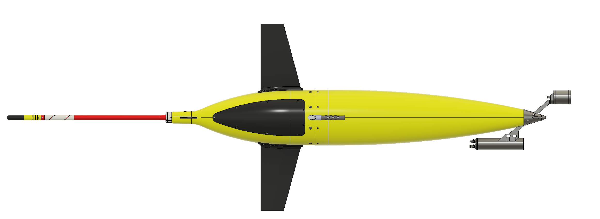
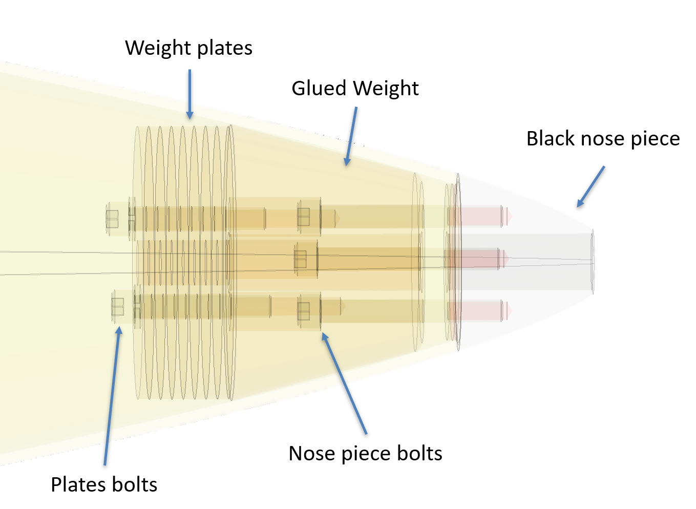
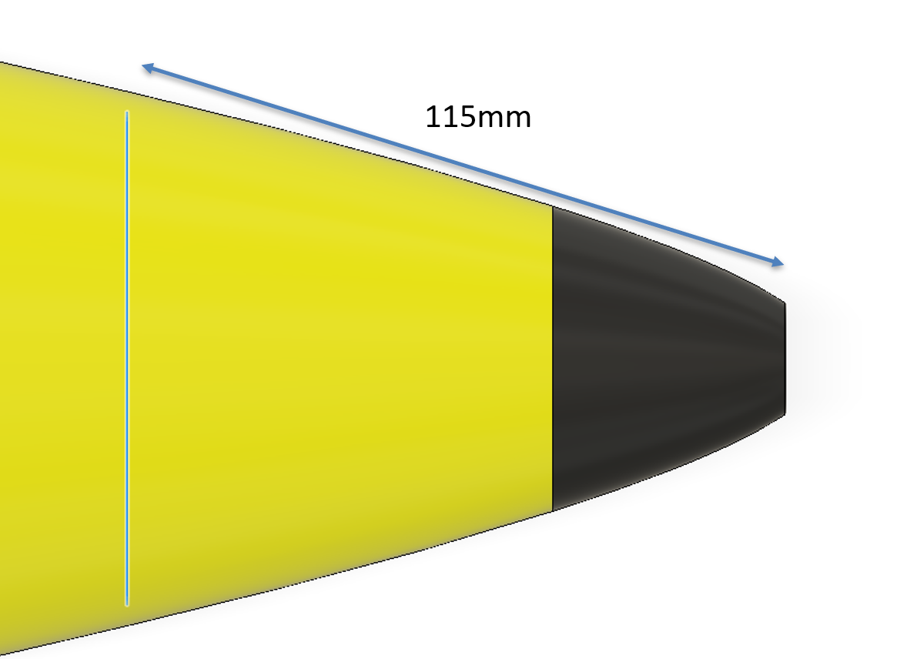
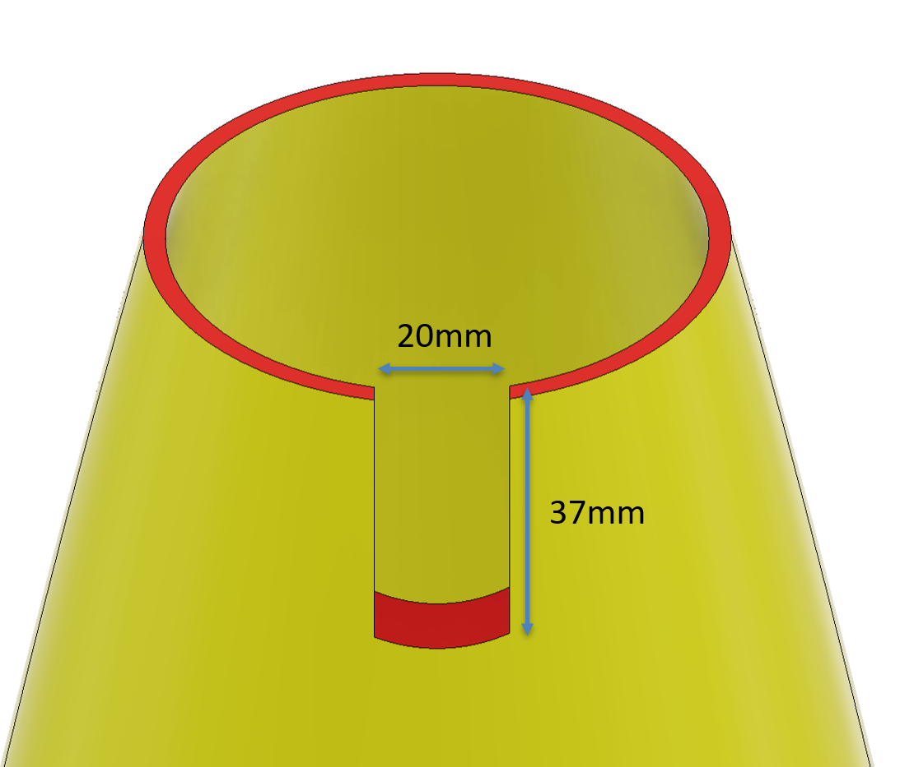
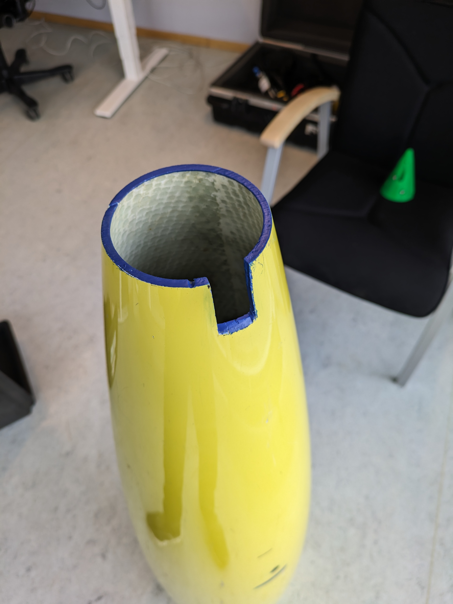
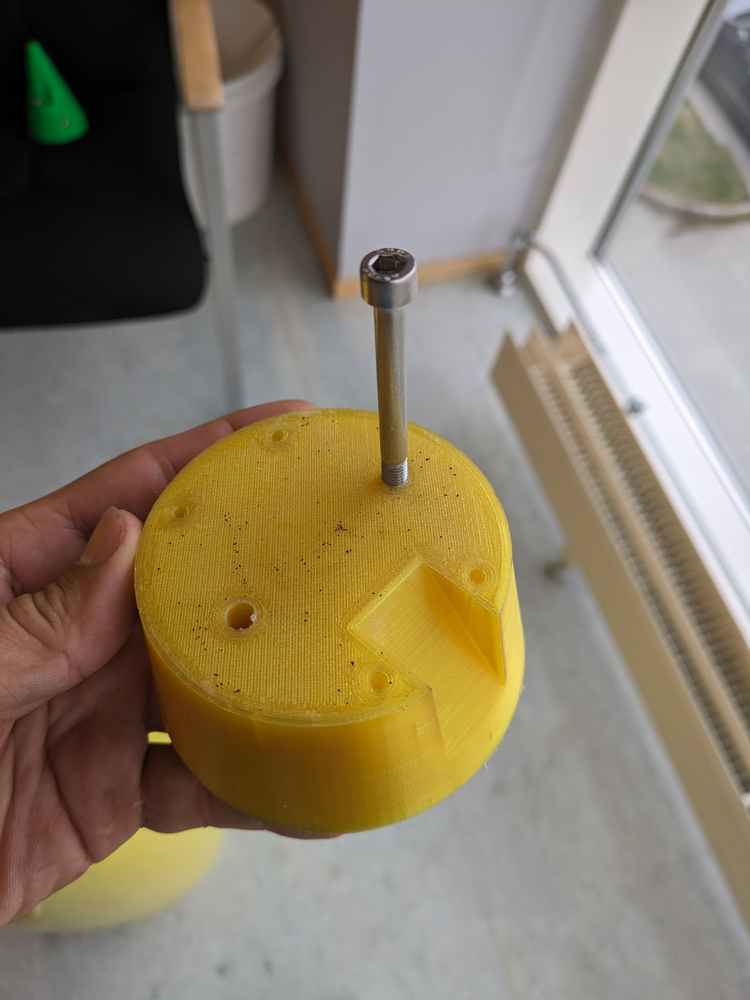
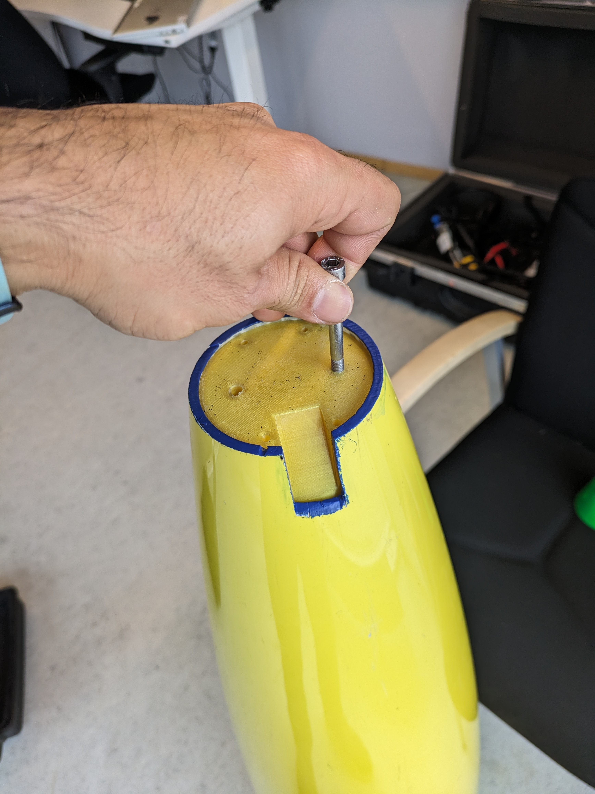
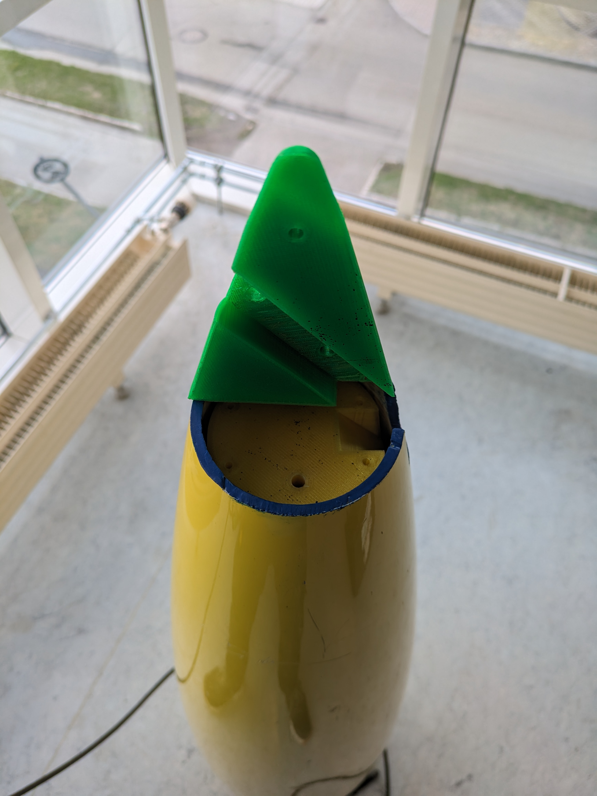
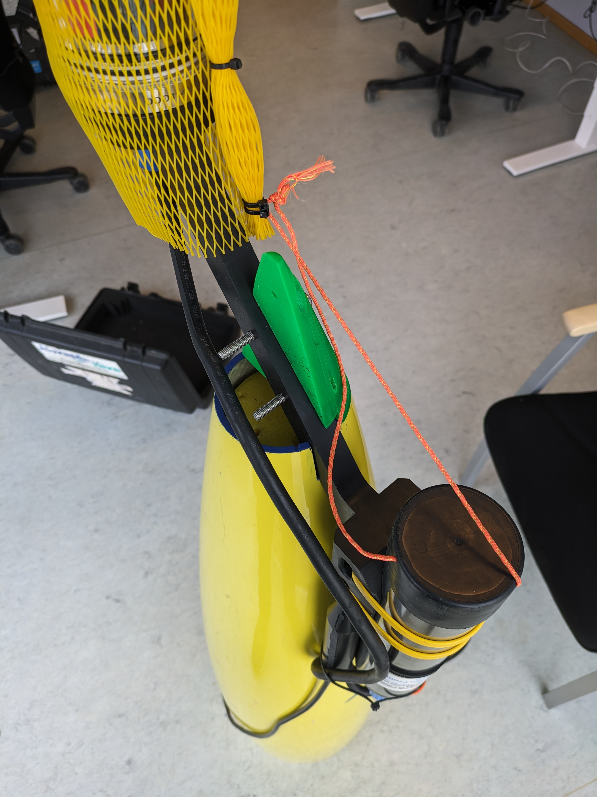
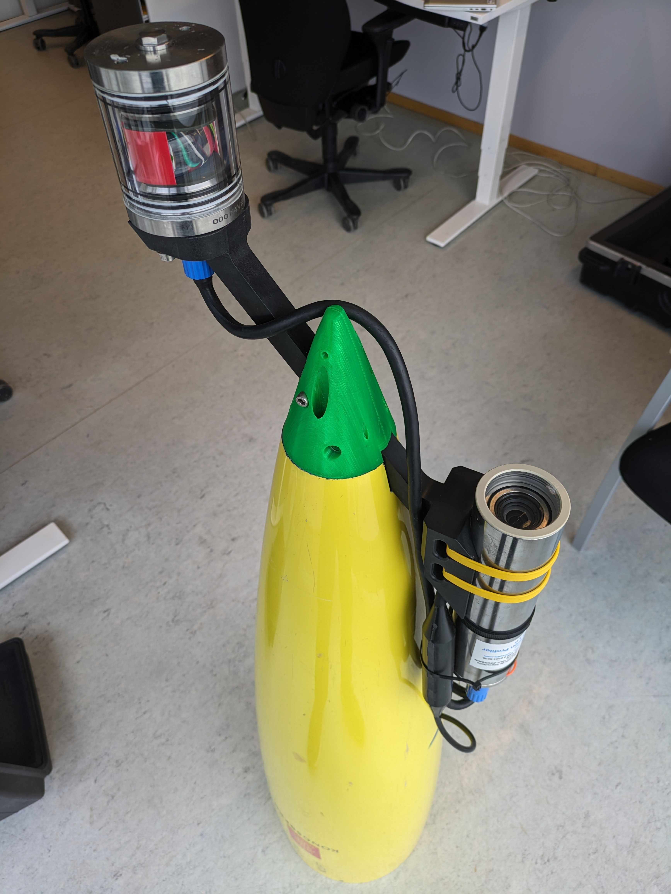

# Integration of UVP6 on Seaglider

The mechanical integration started under the Bioglider project. After a few iterations of mechanical integration, the last deployments in June 2024 and consequently in 2025 resulted in a good Seaglider flight. This integration requires the user to modify their glider front fairing. This includes a few simple cuts of the fiberglass nose and replacing it with a plastic part which also acts as a bracket for the UVP6. Then, in theory, you should be able to remove your UVP6 and still run the glider as before by adding nose weight plates, but I have not tested this yet.

As for software integration, there are basically two ways to run UVP6 on gliders. One is simply by having a pre-defined acquisition profile on UVP6 and just supplying power. This can be easily done without the need of any additional hardware. If you need to change your profile depending on the depth to save power, for instance one for depths above 100 m and another for any depth below 100 m, then you need to add a board. The above-mentioned deployments used this firmware and the corresponding board: <https://github.com/e-abdi/Smart-Cable/tree/DEV>. However, I am planning to move to this version of the board, <https://github.com/e-abdi/SMaRT>, and write a new firmware from scratch for it for the next deployment. There is also an option to transmit near-real-time data and even have it uploaded directly to EcoPART. The board can be installed on the pump assembly reservoir next to the conductivity and temperature boards.

## Fairing modification

Below is a side view of the different parts inside the nose of the front fairing.

- You will need a long extension, at least one meter, to reach the bolts. Remove the plate bolts using a 3/16 hex key.
- Remove all the weight plates until you see the other three bolts holding the nose piece. They might be stuck together, so you might have to push them from the other side using a flat screwdriver.
- Now you need to cut 115 mm off the nose as shown below. I used a metal bandsaw for this and it worked fine. Wear a mask when doing this because you do not want to breathe fiberglass dust.

- You will need a second smaller cut as shown below for the camera arm. I used a normal hacksaw for this.

- Clean the newly cut surface with alcohol and then apply some epoxy paint on it.

## Brackets

I used PETG to 3D print the brackets with 100% infill. You could also machine them in POM. The only thing to note is that POM is slightly denser than PETG, so that should be accounted for while ballasting.

CAD files (STEP):

- [Brackets](mechanical/Brackets.step)
- [Shell parts](mechanical/Shell%20Parts.step)

## Assembly

- Press-fit two locknuts inside the base piece, then attach one of the bolts to it.

- Slide the base piece through the fairing and grab it from the other side.

- Loosely attach the nose-bottom piece.

- Attach the camera arm using two bolts.

- Attach the nose-top piece and tighten all the bolts.

## Ballasting

Depending on how many nose weight plates your glider already has, you will need to carry out a trim-sheet calculation first and then a tank test to verify it prior to deployment. The camera bracket assembly is 510 g heavier in water compared to the piece you have just removed. In our case, we actually had 944 g of weight plates, so we ended up being lighter and had to add some weight bars on the hull just behind the altimeter.

